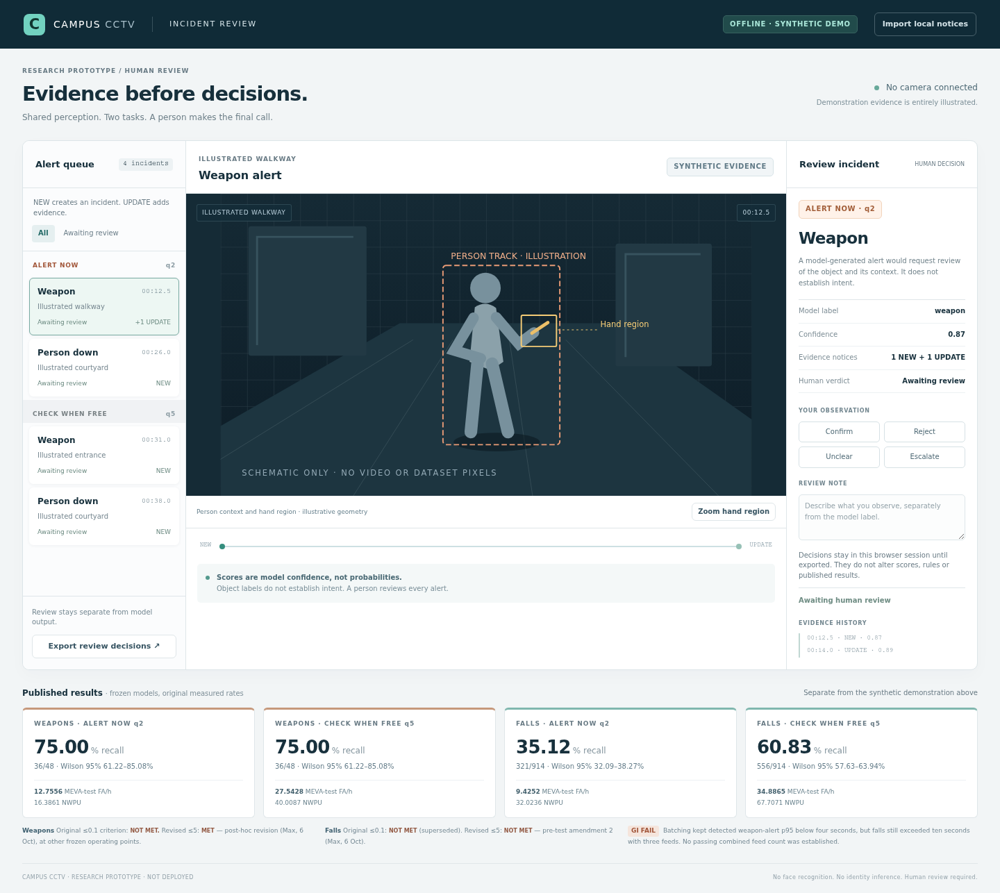
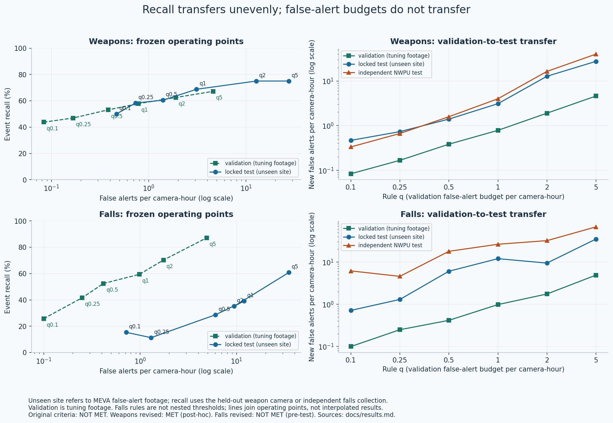
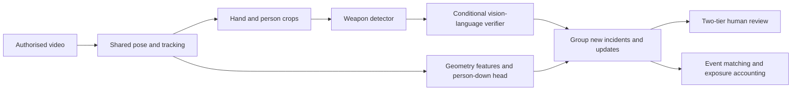
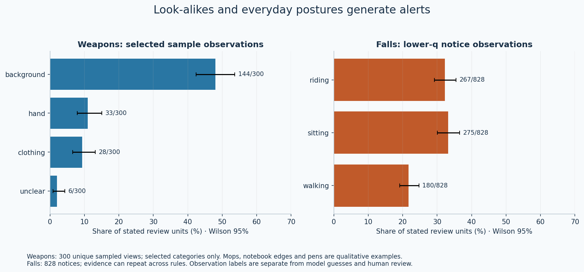
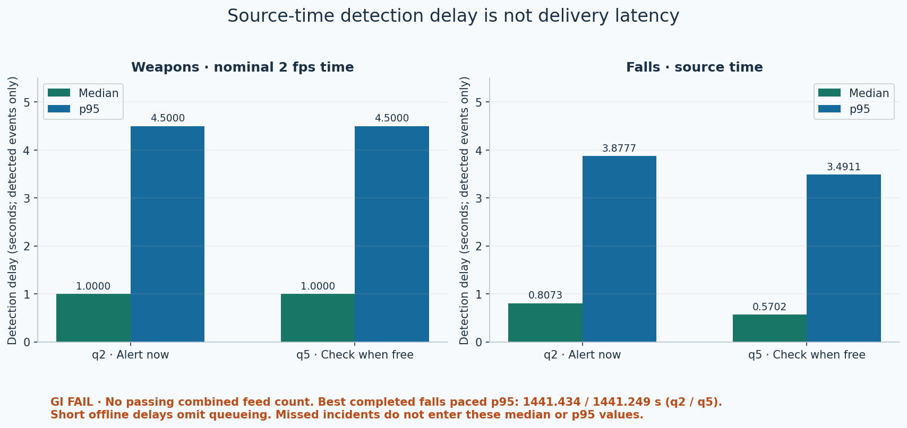

# Campus CCTV Incident Detection

A research prototype that helps people review possible weapons and falls in CCTV footage, with an honest assessment of missed incidents and false alerts at unfamiliar sites.

[](https://github.com/Saizedml/campus-cctv-incident-detection/actions/workflows/ci.yml)
[](LICENSE)
[](pyproject.toml)



*Illustrative interface only: synthetic notices and diagrams; no dataset footage or model inference.*

Built during a research internship at the Cisco–La Trobe Centre for AI and IoT.

**Problem.** Watching CCTV continuously is demanding. Automated alerts could help, but a system that detects staged incidents may overwhelm an operator with false alerts at a new site. This project measures both detection and the review workload it creates.

**Approach.** I led the design of a shared system for detecting and tracking people, checking possible weapons, and recognising when a person is down. It groups repeated detections into incidents and offers urgent and deferred review queues. The detection rules were fixed before the final tests.

**Results.** On held-out test footage the system caught **75% of weapon incidents (36/48)** and **35–61% of falls**, depending on the review tier. At those tiers, false alerts were **5–7× higher** at an unseen test site than on tuning footage. Neither task met its original target, and the combined real-time test did not pass. [Full results and criteria](#results-at-a-glance).

**What I learned.** Detection accuracy alone does not establish deployment readiness. Missed people, misleading objects and delivery delays matter too. The result is a transparent evaluation and human-review workflow, with failures documented alongside successful detections.

## Results at a glance

**Alert now** is the urgent review tier and **Check when free** the deferred tier. They use the q2 and q5 rules, selected to stay within validation budgets of 2 and 5 false alerts per camera-hour. Recall is the share of eligible incidents detected. A camera-hour is one hour of footage from one camera; false-alert rates count new incidents, excluding updates to an existing alert. False alerts are measured on normal footage from two public datasets not used for tuning: MEVA (the held-out test site) and NWPU Campus. These are the original, unadjusted results from the final tests, rounded for display; scores are model confidence, not probabilities. [Full tables and exact values](docs/results.md).

| Task | Tier | Detected / eligible | Recall, 95% confidence interval | MEVA-test false alerts per camera-hour | NWPU false alerts per camera-hour |
|---|---|---|---|---:|---:|
| Weapons | Alert now | 36/48 | 75% (61–85%) | 12.8 | 16.4 |
| Weapons | Check when free | 36/48 | 75% (61–85%) | 27.5 | 40.0 |
| Falls | Alert now | 321/914 | 35% (32–38%) | 9.4 | 32.0 |
| Falls | Check when free | 556/914 | 61% (58–64%) | 34.9 | 67.7 |

**Weapons:** original criterion (≤0.1 false alerts per camera-hour) **NOT MET**. Revised criterion (≤5) **MET**, but revised after the results were known (**post-hoc**). It is met at stricter settings than the two tiers above: at q1, the system caught **69% (33/48)** of weapon incidents at **3.1** false alerts per camera-hour on the MEVA test. [Exact qualifying settings](docs/results.md).

**Falls:** revised criterion (≤5, set before testing) **NOT MET**; original criterion (≤0.1) **NOT MET**. The revised criterion required at least half of eligible incidents to be detected while staying within the limit on the MEVA test.

**Combined real-time test: not passed.** After batching, 95% of detected weapon alerts arrived within four seconds, but falls alerts still exceeded the ten-second limit with three feeds, and the two-feed attempt stopped on a GPU error. No number of simultaneous feeds was shown to meet the limit. [Full combined-test result](docs/results.md).

In the weapons test sequences, median detection delay was **1 s** and the 95th percentile **4.5 s** at both tiers, assuming **2 frames per second**. These figures measure time through recorded footage, not live delivery speed. See the [full aggregate tables](docs/results.md), [evaluation protocol](docs/evaluation_protocol.md) and [model cards](docs/model_cards/).



## Architecture



[Architecture and interfaces](docs/architecture.md) describes the swappable model adapters and the alert record format.

### Key design decisions and trade-offs

- **Cascade:** shared perception supplies task-specific heads. This reduces duplicated work, but a missed person can prevent either task from seeing useful evidence.
- **Vision-language verifier:** explicit `not_weapon` answers veto candidates below the high-score threshold. Skipping verification for high scores preserves recall but admits many look-alikes.
- **Recall-first settings:** each rule maximises incident recall within a validation false-alert budget. The test results show that the budget needs checking at each new site.
- **Two tiers:** urgent and deferred review group detections using only information already seen. Updates can detect an incident missed by the first alert; only new alerts count towards false-alert workload.
- **Generic weapon headline:** subtype guesses are unreliable. The operator sees “weapon”; knife and firearm recall are still evaluated separately.

## Evaluation methodology

Success criteria and event-matching rules were recorded before evaluation; the weapons criterion was later revised, as noted above. Each task was tested once on held-out data using fixed settings. Positive holdouts and negative footage from an unseen site were kept separate from tuning; the public datasets still share actors and staged conditions.

Evaluation matches alerts to incidents within a declared time window and spatial rule, measures normal footage in camera-hours, and reports Wilson 95% intervals for recall and exact one-sided upper bounds for false-alert rates. The public evaluator takes alert and annotation files and outputs aggregate metrics; synthetic test fixtures check edge cases without data or weights. [Protocol](docs/evaluation_protocol.md) · [decisions](docs/decisions.md).

## Failure analysis

**Verifier bypass.** In the urgent tier, **643** new MEVA-test alerts skipped verification because of their high scores. For **610** of them, the verifier's saved answer was `not_weapon`, so they would have been vetoed if checked. This is a post-hoc observation from saved predictions, not a rerun, and because later updates are grouped with earlier alerts it cannot simply be subtracted from the false-alert total.

**Weapon look-alikes.** Mops, notebook edges and pens can look weapon-like within tight crops. Occlusion and hand-crop context matter. Model guesses, assistant observations and human decisions remain separate.

**Falls.** Prone people may be missed by the person detector; frame-edge truncation distorts pose geometry. Sitting, riding/cycling and walking appear among false alerts. A border filter trades fewer false alerts for lost truncated-person detections.





[Detailed failure analysis and limitations](docs/failure_analysis.md).

## Limitations and next steps

The public datasets include staged incidents. The weapons footage reuses some actors and settings. Sequence timing is approximate, and the study used one random seed. Scores are not calibrated probabilities. Finding the right person does not guarantee that the weapon is correctly located or its type correctly identified. Labels in footage used to measure false alerts are incomplete, and reviewers inspected selected frames. Falls were repeatedly tuned on **101** events. In **342/914** test events, the assignment of the person was ambiguous. People can be hidden from view, and clips can cut incidents short. Some cached intermediate results lack full runtime records. Slow collapses were not evaluated. Performance at a campus or on live feeds is not guaranteed. The [model cards](docs/model_cards/) and [full limitations](docs/failure_analysis.md) give more detail.

Post-hoc recommendations, **not applied to the tested models**, are to verify every weapon alert, calibrate site thresholds from normal-footage burn-in, assess a border filter for fixed CCTV, and train a detector on prone people. Further work includes pens/tools/mops, hand-crop padding, cyclist/sitting hard negatives and score calibration. Violence and the separate comparison using newer footage were deferred and were **not run**; [future work](docs/failure_analysis.md) records the planned data and comparison targets.

## Quick start

Use Python **3.12 or newer**. The default installation and tests are CPU-only and need no data or weights.

```bash
python -m venv .venv
source .venv/bin/activate        # Windows: .venv\Scripts\activate
python -m pip install -e ".[dev,dashboard]"
make lint
make test
make figures
make dashboard
```

The dashboard opens an offline synthetic walkthrough. It does not run a model. It supports reviewing the interface without redistributing surveillance footage. [Dashboard instructions](docs/architecture.md#dashboard).

Weights, datasets, annotations and research evidence bundles are **not included**. See [data sources, terms and retraining guidance](docs/data.md) and [third-party model licences](THIRD_PARTY_NOTICES.md). To run authorised local models, supply the environment variables named in [runtime configuration](configs/runtime.yaml), then validate input availability:

```bash
python scripts/run_pipeline.py --config configs/runtime.yaml --check-inputs
python scripts/evaluate.py --help
```

Installing and running the optional model adapters is a separate step, and the CPU tests do not guarantee identical model outputs on other hardware or software. No dataset demo bundle is shipped: obtain authorised footage separately and use it only under its redistribution and attribution terms. [Media sources](docs/media_sources.md).

## Repository structure

```text
src/campus_cctv/  perception, weapons, falls, events, evaluation, dashboard
configs/         portable runtime settings and frozen operating rules
scripts/         pipeline, evaluation and aggregate figure entry points
tests/           synthetic CPU boundary tests
docs/            protocol, results, model cards, data and process
results/         small aggregate JSON; no event records
assets/          original plots, diagrams and synthetic interface captures
```

## How this was built

**My role.** I designed the approach from a literature review, chose the datasets, wrote the evaluation protocol and success criteria, reviewed the results and footage myself, and made every go/no-go decision across 26 documented gates. I directed AI coding agents (OpenAI Codex and Claude Code), which wrote most of the code within that gated process.

Key decisions I made:
- Paired a crop detector with a conditional multimodal LLM verifier to keep small-object evidence while limiting verifier cost.
- Switched to generic weapon alerts after knife/firearm class guesses proved unreliable.
- Kept the original targets on record as NOT MET and labelled the later criterion revision as post-hoc rather than presenting it as a pass.
- Preserved the failed combined real-time test instead of changing system behaviour to obtain a pass.

This repo is a curated release. The full experiment history, including 26 review checkpoints ("gates") where code and settings were frozen and approved before the next step, is kept in a private research repository. [The gated process](docs/process.md) records freezes, failed gates, declared deviations and human approvals.

## Responsible use

The system detects objects and posture, not identity. There is no face recognition. A human reviews every alert; this is a research prototype and is not deployed. False accusations, excessive monitoring, dataset bias and use outside consent or purpose limitations are material misuse risks. An alert is a cue for review, never evidence of intent or guilt. [Responsible use](docs/responsible_use.md).

## Acknowledgements, citation and licence

Thanks to my supervisor Phu, the Cisco–La Trobe Centre for AI and IoT, and the dataset authors. Their support does not imply endorsement of every result or future use.

Use [CITATION.cff](CITATION.cff) to cite this release. Original project code and original media use the [MIT licence](LICENSE), copyright Max Blunden-Slusarski. External models, software and datasets retain their own terms; the optional Ultralytics integration is **AGPL-3.0** unless separately licensed. [Third-party notices](THIRD_PARTY_NOTICES.md). Changes between releases are listed in the [changelog](CHANGELOG.md).
