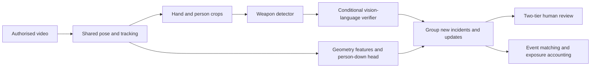

# Campus CCTV Incident Detection

A research prototype that helps people review possible weapons and falls in CCTV footage, with an honest assessment of missed incidents and false alerts at unfamiliar sites.

[](https://github.com/Saizedml/campus-cctv-incident-detection/actions/workflows/ci.yml)
[](LICENSE)
[](pyproject.toml)


*Illustrative interface only: synthetic notices and diagrams; no dataset footage or model inference.*

Built during a research internship at the Cisco–La Trobe Centre for AI and IoT.

**Problem.** Watching CCTV continuously is demanding. Automated alerts could help, but a system that detects staged incidents may overwhelm an operator with false alerts at a new site. This project measures both detection and the review workload it creates.

**Approach.** I led the design of a shared system for detecting and tracking people, checking possible weapons, and recognising when a person is down. It groups repeated detections into incidents and offers urgent and deferred review queues. The detection rules were fixed before the final tests.

**Results.** Weapons were detected in **75% (36/48)** of incidents at both alert settings. Falls were detected in **35% (321/914)** and **61% (556/914)**. At those settings, false alerts were broadly **4–9×** higher at the held-out MEVA site than on tuning footage. Both original criteria were **NOT MET**. The revised weapons criterion was **MET**, but changed after seeing results (**post-hoc**). The revised falls criterion was set before testing (**pre-test**) and was **NOT MET**. **Combined real-time test (weapons and falls on several feeds at once): not passed**.

**What I learned.** Detection accuracy alone does not establish deployment readiness. Missed people, misleading objects and delivery delays matter too. The result is a transparent evaluation and human-review workflow, with failures documented alongside successful detections.

**Scores are model confidence, not probabilities.**

## Results at a glance

**Alert now** is the urgent review tier; **Check when free** is the deferred tier. Recall is the share of eligible incidents detected. A camera-hour is one hour of footage from one camera; false-alert rates count new incidents, excluding updates to an existing alert. These are the original, unadjusted results from the final tests. Displayed values are rounded; [full tables and exact values](docs/results.md) retain every frozen operating point.

| Task | Tier | Detected / eligible | Recall, 95% confidence interval | MEVA-test false alerts per camera-hour | NWPU false alerts per camera-hour |
|---|---|---|---|---:|---:|
| Weapons | Alert now | 36/48 | 75% (61–85%) | 12.8 | 16.4 |
| Weapons | Check when free | 36/48 | 75% (61–85%) | 27.5 | 40.0 |
| Falls | Alert now | 321/914 | 35% (32–38%) | 9.4 | 32.0 |
| Falls | Check when free | 556/914 | 61% (58–64%) | 34.9 | 67.7 |

**Weapons: Original pre-registered ≤0.1 criterion: NOT MET. Revised ≤5 criterion: MET, post-hoc revision (Max, 6 Oct), after weapons locked results were known.** These limits are measured false alerts per camera-hour. The qualifying frozen rules are stricter than the two displayed review tiers; [exact qualifying rules](docs/results.md) are reported separately.

**Falls: revised primary ≤5 criterion (pre-test amendment 2, Max, 6 Oct): NOT MET; original pre-registered ≤0.1, superseded but retained: NOT MET.** The revised criterion requires at least half of eligible incidents at an actual MEVA-test rate within the limit. Human acceptance of the research deliverable is separate from numerical success.

**Combined delivery test: not passed (gate GI).** After batching, 95% of detected weapon alerts arrived within four seconds, but falls still exceeded the ten-second limit with three feeds. The two-feed attempt stopped on a graphics-device error. No passing combined feed count was established. See the [full GI result and limitations](docs/results.md).

In the weapons test sequences, median detection delay was **1 s** and the 95th percentile was **4.5 s** at both tiers, assuming **2 frames per second**. These timings measure progress through recorded frames, not live delivery speed, and do not override the failed combined delivery test. See the [full aggregate tables](docs/results.md), [evaluation protocol](docs/evaluation_protocol.md) and [model cards](docs/model_cards/).


## Architecture




[Architecture and interfaces](docs/architecture.md) explain the portable model adapters and notice schema.

### Key design decisions and trade-offs

- **Cascade:** shared perception supplies task-specific heads. This reduces duplicated work, but a missed person can prevent either task from seeing useful evidence.
- **Vision-language verifier:** explicit `not_weapon` answers veto candidates below the high-score threshold. Frozen high-score bypass preserves recall but admits many look-alikes.
- **Recall-first operating points:** selection maximises incident recall within a validation false-alert budget. Test results show why that budget needs site-specific validation.
- **Two tiers:** urgent and deferred review group detections using only information already seen. Updates can detect an incident missed by the first alert; only new alerts count towards false-alert workload.
- **Generic weapon headline:** subtype guesses are unreliable. The operator sees “weapon”; knife and firearm recall are still evaluated separately.

## Evaluation methodology

Success criteria and event matching were recorded before evaluation; the weapons acceptance criterion was subsequently revised **post-hoc**, while the falls amendment was **pre-test**. Each frozen task's locked test ran once. Positive holdouts and negative footage from an unseen site were kept separate from tuning; the public datasets still share actors and staged conditions.

Evaluation matches notices to incidents within the declared window and spatial rule, measures negative exposure in camera-hours, and reports Wilson recall intervals and exact one-sided false-alert bounds. Dataset-specific denominators are retained. The public evaluator accepts supplied notice and annotation files and emits aggregate metrics; synthetic fixtures exercise boundary behaviour without data or weights. [Protocol](docs/evaluation_protocol.md) · [decisions](docs/decisions.md).

## Failure analysis

**Verifier bypass.** Of **643** new MEVA-test alerts that bypassed verification in the urgent tier, **610** had saved `not_weapon` answers that would trigger a veto if checked. This is a post-hoc observation from saved predictions, not a rerun of an always-verify pipeline; continuation grouping means it cannot simply be subtracted from the original false-alert total.

**Weapon look-alikes.** Mops, notebook edges and pens can look weapon-like within tight crops. Occlusion and hand-crop context matter. Model guesses, assistant observations and human decisions remain separate.

**Falls.** Prone people may be missed by the person detector; frame-edge truncation distorts pose geometry. Sitting, riding/cycling and walking appear among false alerts. A border filter trades fewer false alerts for lost truncated-person detections.


[Detailed failure analysis and limitations](docs/failure_analysis.md).

## Limitations and next steps

The evidence comes from public/staged datasets with shared USRT actors/scenes, nominal sequence timing and one seed. Scores are uncalibrated; subtype guesses and person-level matches do not guarantee correct weapon-box localisation. Negative annotations are incomplete and review uses sampled keyframes. Falls were repeatedly tuned on **101** events; **342/914** locked assignments were ambiguous, with occlusion and clip censoring. Historical negative perception caches lack execution-linked runtime/package provenance despite matching hashes and exact prefix checks. There is no slow-collapse result or campus/live-capacity guarantee. The **combined delivery test (GI) was not passed**. The [model cards](docs/model_cards/) and [full limitations](docs/failure_analysis.md) retain further evaluation details.

Post-hoc recommendations, **not applied to the frozen models**, are to verify every weapon alert, calibrate site thresholds from normal-footage burn-in, assess a border filter for fixed CCTV, and train a detector on prone people. Further work includes pens/tools/mops, hand-crop padding, cyclist/sitting hard negatives and score calibration. Violence and the separate D8 recency experiment were deferred and were **not run**; [future work](docs/failure_analysis.md) records the planned data and comparison targets.

## Quick start

Use Python **3.12 or newer**. The default installation and tests are CPU-only and need no data or weights.

```bash
python -m venv .venv
# Activate the environment using your shell's usual command.
python -m pip install -e '.[dev,dashboard]'
make lint
make test
make figures
make dashboard
```

The dashboard opens an offline synthetic walkthrough. It does not run a model. It supports reviewing the interface without redistributing surveillance footage. [Dashboard instructions](docs/architecture.md#dashboard).

Weights, datasets, annotations and research evidence bundles are **not included**. See [data sources, terms and retraining guidance](docs/data.md) and [third-party model licences](THIRD_PARTY_NOTICES.md). To run authorised local models, supply the environment variables named in [runtime configuration](configs/runtime.yaml), then validate input availability:

```bash
python scripts/run_pipeline.py --config configs/runtime.yaml --check-inputs
python scripts/evaluate.py --help
```

Installing and executing the optional model adapters is a separate step. The public CPU checks do not claim end-to-end inference identity across environments. No dataset demo bundle is shipped: obtain authorised validation/demo footage separately and build a local bundle only under its redistribution and attribution terms. Any future redistributable sample bundle belongs in a release asset, not source history. [Media sources](docs/media_sources.md).

## Repository structure

```text
src/campus_cctv/  perception, weapons, falls, events, evaluation, dashboard
configs/         portable runtime settings and frozen operating rules
scripts/         pipeline, evaluation and aggregate figure entry points
tests/           synthetic CPU boundary tests
docs/            protocol, results, model cards, data and process
results/         small aggregate JSON; no event records
assets/          original plots, diagrams and synthetic interface captures
```

## How this was built

I designed the approach from a literature review, chose the datasets, wrote the evaluation protocol and success criteria, reviewed the results and footage myself, and made every go/no-go decision. AI coding agents (OpenAI Codex) wrote most of the code under that gated process.

This repo is a curated release; the full experiment history (**26 gates** and the experiment registry) is kept in a private research repository. [The gated process](docs/process.md) records freezes, failed gates, declared deviations and human approvals.

## Responsible use

The system detects objects and posture, not identity. There is no face recognition. A human reviews every alert; this is a research prototype and is not deployed. False accusations, excessive monitoring, dataset bias and use outside consent or purpose limitations are material misuse risks. An alert is a cue for review, never evidence of intent or guilt. [Responsible use](docs/responsible_use.md).

## Acknowledgements, citation and licence

Thanks to my supervisor Phu, the Cisco–La Trobe Centre for AI and IoT, and the dataset authors. Their support does not imply endorsement of every result or future use.

Use [CITATION.cff](CITATION.cff) to cite this release. Original project code and original media use the [MIT licence](LICENSE), copyright Max Blunden-Slusarski. External models, software and datasets retain their own terms; the optional Ultralytics integration is **AGPL-3.0** unless separately licensed. [Third-party notices](THIRD_PARTY_NOTICES.md).
