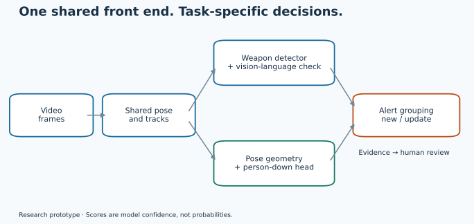
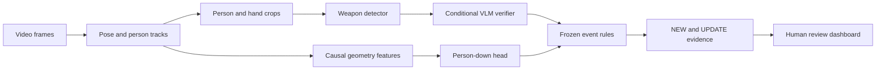

# Architecture

The research pipeline shares person localisation, pose and tracking across tasks, then applies task-specific heads and causal event rules. It organises evidence for human review; it does not identify people.

The shared front end is YOLO26 pose with BoT-SORT tracking. The weapon arm uses RF-DETR-L fine-tuned with mined hard negatives and restored firearm examples, then a Qwen3-VL verifier. The falls arm uses the geometry-only FB0 temporal head and the R4 down-or-fall-peak rule. Frame sampling, score pooling, persistence, cooldown and operating-point settings are causal; later frames cannot change an already-issued decision.

The two tiers are **Alert now (q2)** and **Check when free (q5)**. The threshold labels describe validation budgets. Their actual test rates are much higher. The verifier can veto an explicit `not_weapon` answer below the frozen high-score threshold; high scores skip that veto. This choice preserved recall on validation but contributed substantially to test false alerts.

Weapon notices say **weapon**, even if the detector suggests knife or firearm. Subtype scores were unreliable. Falls notices say **person down**, without a medical diagnosis or intent inference. Scores are model confidence, not probabilities.

NEW creates an alert; matching continuation is attached as UPDATE during the task cooldown. The evaluator counts UPDATEs towards event recall and only NEW towards false alerts per camera-hour. Evidence packages preserve the source time, track association, score and generating detection so a reviewer can inspect the basis of a notice.

## Dashboard

The curated runner emits immediate validated NEW/UPDATE notices to `notices.jsonl`, marked `pending_postroll`. It writes completed metadata to `notices.evidence.jsonl` after collecting the frozen same-track box history around each notice. Completing post-roll evidence does not change the decision time, score or NEW/UPDATE identity and does not delay the immediate notice. Use the completed metadata as evaluator input. No movie or image writer is included; the metadata output is not a complete research evidence bundle. The optional inference adapters require separately obtained weights and licences.

Run `python -m campus_cctv.dashboard` for the offline synthetic walkthrough, or add `--no-open --output output/dashboard` to generate it without opening a browser. The generated HTML uses no server and makes no network requests. Its local import expects a JSON array, so convert a supplied JSONL stream to an array before importing. Review decisions export to `review-decisions.json`; imported media stays masked. Synthetic diagrams demonstrate queue, detail, zoom and skeleton mechanics, not model accuracy.

The public dashboard uses clearly marked synthetic examples. Its refresh speed is not inference latency. **Combined real-time test: not passed.** No number of simultaneous feeds was shown to meet the alert-delay limit. Batching improved weapon latency, but the shared combined workload still missed the falls latency budget. See [full results](results.md) and [responsible use](responsible_use.md).
