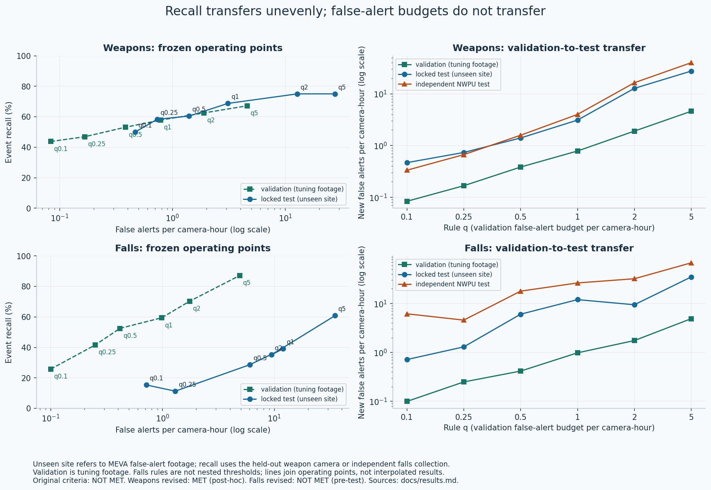
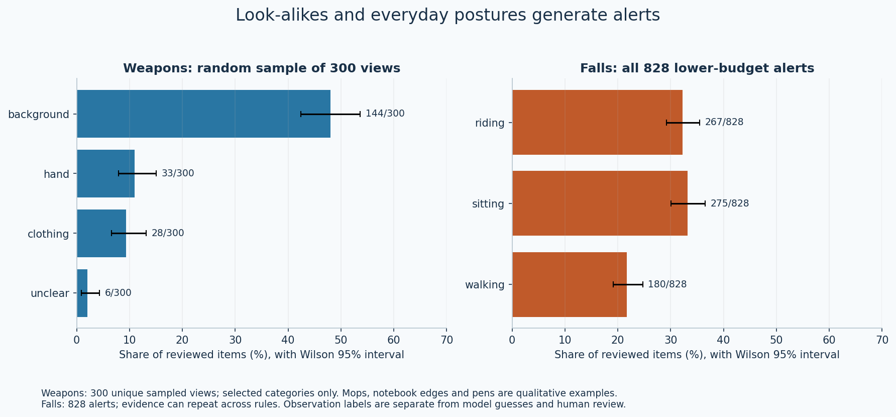
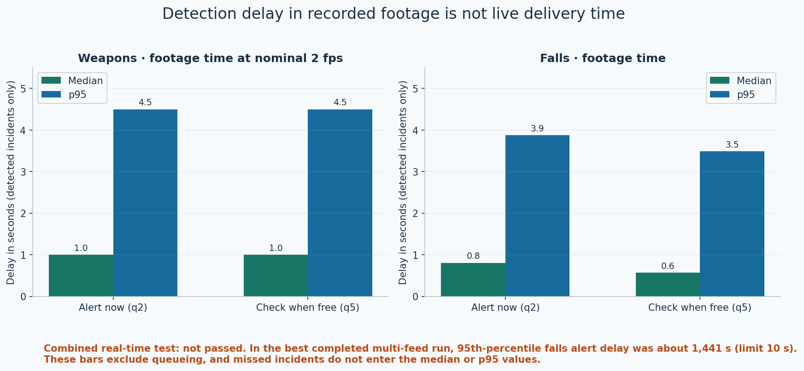

# Failure analysis and limitations

The main result is a transfer gap: weapon recall remains **75.00% at both tiers**, while false-alert rates rise substantially on new sites. MEVA-test q2/q5 ratios are **6.72×/5.99× for weapons** and **5.39×/7.12× for falls**. NWPU ratios are **8.63×/8.70×** and **18.31×/13.82×**, respectively. These within-task ratios do not compare the difficulty of the two positive tasks. Scene changes and shared perception are plausible contributors, not isolated causal findings.

## Weapon look-alikes and verifier bypass

Partly occluded mops and broom handles, notebook edges and pen-like objects can resemble weapons in a hand crop. Crop boundaries can obscure context. The observed notebook-like edge received a knife score of 0.936819. This is an assistant observation, not relabelled ground truth. The training view contained only five pen boxes and no screwdriver or flashlight boxes.

Of **643** q2 MEVA-test NEW alerts that bypassed V, **610** had saved `not_weapon` answers and would have met the frozen verifier veto if it were applied to those individual candidates. NWPU has 166 bypasses, with 159 saved `not_weapon` answers. These are **post-hoc, test-informed saved-prediction observations**, not rerun outcomes. Removing those notices arithmetically cannot reconstruct a new policy: changing an early notice changes later NEW/UPDATE identities. The q1-to-q2 bypass change gains three positive incidents (33→36/48).

In a validation-only diagnostic, applying V to every alert gave 37/64 incidents at 0.78 FA/h, versus 40/64 at 1.90 FA/h for the frozen rules. This was not adopted. V is not a guaranteed cure for false alerts and can remove true positives.

The weapon bars show selected categories from the 300-view random sample. Mops, notebook edges and pens are qualitative failure examples, not frequency estimates. The falls bars show a lower-q notice census; repeated evidence can appear across rules. Neither plot is a ground-truth causal taxonomy.

## Falls: missing people and misleading geometry

Prone people can disappear from the person detector; occlusion can break tracks. At q2/q5, 130/109 missed events have no assigned track in the post-fall window, but 21/20 of those clips end before that window starts. Clip censoring cannot establish a detector failure. Other misses retain a track without satisfying the frozen head/rule conditions.

Frame-edge truncation changes box geometry and can cause false fall peaks. The border veto is on at q0.1/q0.5/q1 and off at q0.25/q2/q5. It reduced validation edge alerts but lost genuine tuning events. The q2/q5 tiers have no border-veto misses; observing a truncated box is a separate diagnostic. Applying a border filter to web clips can suppress true falls.

Sitting, riding/cycling and walking account for 275/828, 267/828 and 180/828 observations in the lower-q falls notice census. In the 150-view upper-q sample, walking is 76/150, sitting 37/150 and riding 25/150. These are visible-posture descriptions, not adjudicated incident labels. No clear genuine fall was identified in the reviewed negative snippets; uncertain and unreviewed views remain counted.

## Timing and capacity

Source-time delay is conditional on detected events and excludes missed incidents. Weapon sequence time is nominal; falls delay follows source timestamps. **Combined real-time test: not passed.** No number of simultaneous feeds was shown to meet the alert-delay limit. Batching brought detected weapon p95 below four seconds, while falls exceeded ten seconds even at three feeds. The two-feed fallback failed in the verifier; one feed was not attempted. Cached dashboard playback is not an inference benchmark.

## Consolidated limitations

- Data are public, staged or selected research footage. USRT shares actors, scene and knife appearance across cameras. Training sources contain close-up web images and imperfectly documented provenance. New-campus performance is unmeasured.
- Sequential weapon timing is nominal 2 fps, not continuous physical incident timing. Positive sequences supply no negative exposure. Negative rates come only from MEVA and NWPU.
- One training seed was evaluated. Validation rule selection reused the same 101 falls across three rounds, so validation performance is optimistically selected.
- Scores are model confidence, not probabilities. Neither task is calibrated; weapon subtype guesses are unreliable. In one validation diagnostic, 46% of localised firearm boxes were labelled knife.
- Primary weapon matching is person-level. Only 25/36 first-credited q2 detections overlap the synchronous object; secondary any-alert localisation is 33/48. Low-scoring cached boxes do not establish reliable detection.
- Negative labels are incomplete and visual review is sampled/keyframe-based. Original false-alert rates can include genuine objects. Human-adjusted rates are secondary; uncertainty and outside-sample evidence are retained.
- Falls subject assignment is ambiguous for 342/914 events and can follow a bystander. Occlusion, missing prone-person detections and short clip endings constrain interpretation. No post-test reassignment or exclusion was made.
- Border truncation produces geometry artefacts. Border suppression has recall costs; it is not a universally safe fix.
- Historical runtime/package identity is missing for the reused negative perception caches. All 1,053 payload hashes matched, and three short current-runtime checks were exact, but this does not recover execution provenance or establish whole-dataset identity.
- Greedy verifier decoding can vary by hardware: one of 17 repeated validation inputs changed answer across GPU types. No additional training seed or locked rerun was performed.
- Original reference models have no measured locked weapon-event rows. Their separate Dangerous Items frame AP does not supply those missing comparisons.
- Falls frame scores include 22,713 missing-subject errors among 95,373 labelled samples. Five-class macro-F1 is 0.2568; six-class is 0.2163; tracked-subject-only 0.3000 is secondary.
- No separate slow-collapse result exists. Appearance/video ablations, further falls head comparisons and score calibration were not completed. Lying-specific false-alert coverage is limited.
- The paced test mixed nominal-rate weapon sequences with higher-rate falls/negative footage. Repeated loops are not independent accuracy trials or a certification of native multi-camera capacity. The combined real-time test failed, and the hardware failure's cause is unestablished.
- No live deployment, campus reliability, autonomous intervention, face recognition or identity capability is claimed. Neither human acceptance nor a dashboard run-through upgrades failed numerical criteria.

## Additional interpretation boundaries

**Exposure and site coverage.** Unusual resolutions and short camera exposures complicate per-camera rate comparisons. NWPU IR/night/PTZ metadata is unavailable. Weapon false alerts are concentrated but not confined to a small part of the test: three school cameras contribute 70.37% of q2 MEVA NEW alerts, while all 12 test cameras and 30/42 evaluated NWPU locations produce q2 alerts. Falls also show camera/activity concentration. The school-site resemblance to a campus is a deployment judgement, not measured campus performance. At only 12.0224 camera-hours, NWPU cannot certify q0.1 even with zero false alerts. No listed frozen point meets its exact upper-bound certification on either negative set.

**Miss and localisation definitions.** At each weapon dashboard tier, 12/48 events are missed: ten fall below the person-associated detector threshold and two have no qualifying tracked holder. No tier miss is attributed to V veto. A missing qualifying holder does not mean no person was detected anywhere. The broad retained-box search finds overlap for 36/36 credited q2 events at the 0.001 floor, but only 32/36 at the alert threshold; those low-score boxes are not reliable detections. First-credited, any-alert and arbitrary cached-box diagnostics answer different questions. Validation has 31/61 unmatched NEW notices at q2/q5; these add no negative exposure. Falls frame diagnostics cover sampled 10 Hz timestamps rather than every native video frame, and a post-fall assigned-track box does not prove the correct person was followed.

**Review scope.** The 300-view weapon sample contains 235 MEVA and 65 NWPU views. Identical evidence maps to 746 of 3,098 tier notices, but this does not enlarge the random sample. The remaining 2,352 tier notices and 90 other-q miss rows were not individually reviewed. Falls upper-q output has 4,896 notices and 3,542 unique views; 3,392 views lie outside its 150-view random sample, although some also have reviewed lower-q evidence. A further 543 q2 falls misses are outside visual review. Some neighbouring views show the same object. Assistant suspicions are neither human confirmation nor proof of a prop; an outside-sample view is unassessed. In the falls miss sample, “falling” describes visible motion in 37/50 snippets and does not validate the assigned subject or reject other ground truth.

**Secondary exclusions and provenance.** Human-confirmed weapon point views are not fully annotated incident intervals. Their secondary notice exclusions leave exposure, subtype rates, NWPU rates and recall unchanged; they cannot justify removing time or extrapolating to other views. Dedicated historical tracker-parameter identity is also absent from the reused-cache record. Later hash and prefix agreement does not establish execution identity. The reported absence of a memory-growth flag in completed combined-test hours is limited to those schedules and checks; the failed partial run provides no completed-hour certification.

## Next steps, post-hoc recommendations, not applied

Test V on every weapon alert, with its recall cost measured; establish per-site thresholds from a burn-in period of normal footage; add pens, tools and mops to training; test hand-crop padding; and calibrate scores on separate data. For fixed CCTV, test the border filter and report truncated-person losses. Train/evaluate a person detector on people lying on the ground, and add cyclist/sitting hard negatives for falls. Any changed model needs a new evaluation.

Violence was deferred to prioritise weapons, falls and the deadline. The planned D4.1/GV1 target is Garcia-Cobo and SanMiguel's pose/change-detection/ConvLSTM reproduction within two percentage points of 90.25%; D4.3 would compare frozen V-JEPA 2 features with a linear head for transfer. No violence model was built. [Data options and licence constraints](data.md) include RWF-2000, SCVD, SCFD, AIRTLab and Bus Violence; UBI-Fights needs clearance.

The D8 recency experiment was not run. Its separate CCTV-Gun staged-to-real handgun/person comparison remains future work, not part of this pipeline or dashboard.

**Public-release verification scope:** CPU rule/feature parity and stored-notice evaluation were checked. No model inference, pixel-to-notice runtime equivalence or optional inference-environment installation was tested during curation. Frozen research results do not certify a new hardware/software environment.
